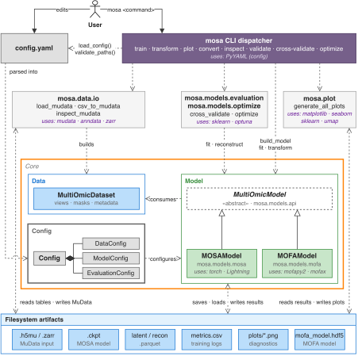

# Code architecture

[Documentation](../index.md)

The data layer and experiment workflow are independent of a model's training framework. Each registered model receives the same dataset container and owns its numerical preprocessing, fitting, and prediction.

| Layer | Main source | Responsibility |
|---|---|---|
| CLI | [cli.py](../../src/mosa/cli.py) | Parse commands, load input, create a training holdout, invoke model operations, and write command-level reports. |
| Shared configuration | [config.py](../../src/mosa/config.py), [utils.py](../../src/mosa/utils.py) | Parse data/evaluation settings, dispatch model configuration, and validate against file structure. |
| Data | [data/io.py](../../src/mosa/data/io.py), [data/dataset.py](../../src/mosa/data/dataset.py) | Convert/load [MuData](https://mudata.scverse.org/stable/) and pass aligned views, masks, metadata, and feature names to models. |
| Model boundary | [models/api.py](../../src/mosa/models/api.py), [models/registry.py](../../src/mosa/models/registry.py) | Define operations, construct registered models, and dispatch saved-model loading. |
| Evaluation | [models/evaluation.py](../../src/mosa/models/evaluation.py) | Fit fresh fold models, score observed held-out reconstructions, and pool NMSE. |
| Optimization | [models/optimize.py](../../src/mosa/models/optimize.py) | Sample top-level model settings and evaluate each trial with cross-validation. |
| MOSA VAE | [models/mosa/](../../src/mosa/models/mosa) | VAE-specific configuration, preprocessing, [Lightning](https://lightning.ai/docs/pytorch/stable/) training, and architecture. |
| External [MOFA](https://biofam.github.io/MOFA2/) adapter | [models/mofa/](../../src/mosa/models/mofa) | Translate the model interface to [mofapy2](https://biofam.github.io/MOFA2/)/[mofax](https://github.com/bioFAM/mofax) operations and files. |
| Plotting | [plot.py](../../src/mosa/plot.py) | Read saved outputs and metadata to generate diagnostics. |

  

## Training lifecycle

The CLI loads the configuration, validates it against the input structure, and loads a `MultiOmicDataset`. It creates the configured training/validation holdout, selects a model through `build_model()`, calls `fit(train, val, resume_from=...)`, and then calls `save_outputs()`.

Model registration occurs on import. [mosa.models](../../src/mosa/models/__init__.py) imports the current adapters; each module registers a configuration/model pair through a decorator. The registry itself imports no concrete model implementations.

## Evaluation lifecycle

Cross-validation creates subsets of the loaded dataset, then constructs a fresh model and configuration copy for each fold. A temporary output directory isolates fold artifacts. It calls `fit(train, val)` and `reconstruct(val)` before scoring the original-scale predictions against observed values. The temporary directory is removed after each fold.

Optimization wraps this same operation. It changes model fields while holding the data and evaluation protocol fixed. Neither workflow needs to know whether the model uses [Lightning](https://lightning.ai/docs/pytorch/stable/), an external factor model, or another framework.

## Saved-model lifecycle

[`transform`](../reference/commands/transform.md) asks the registry which model owns the saved file. After loading, it reads `data_cfg` from the model to choose input views and masks, predicts through `transform()` and optional `reconstruct()`, and writes results in the supplied sample order.

The registry must know the adapter before both [YAML](https://yaml.org/) dispatch and saved-file dispatch. A separately packaged adapter can be imported by a launcher; it does not require a new branch in the shared CLI. See [Adding a model](adding-models.md#make-the-registration-available).

## MOSA VAE implementation

The VAE adapter connects the shared model interface to a [Lightning](https://lightning.ai/docs/pytorch/stable/) data module and training module. The data module fits preprocessing and prepares minibatches; the training module composes per-view encoders and decoders, latent fusion, and optional objectives.

  

