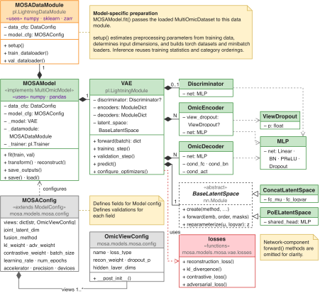

# Modifying the MOSA VAE

A change within the VAE usually belongs in its implementation rather than a new library adapter. Keep the public `fit`, `transform`, and `reconstruct` behaviour consistent so the library can continue to evaluate and save the model.

## Locate the change

| Change | Implementation |
|---|---|
| Encoder or decoder layers | [Encoder](../../src/mosa/models/mosa/vae/encoder.py), [decoder](../../src/mosa/models/mosa/vae/decoder.py), and shared [layers](../../src/mosa/models/mosa/vae/layers.py) and their construction in [VAE](../../src/mosa/models/mosa/vae/vae_module.py) |
| Combination of view embeddings | [Latent-space implementations](../../src/mosa/models/mosa/vae/latent.py) |
| Losses, discriminator updates, or optimizer scheduling | [VAE training module](../../src/mosa/models/mosa/vae/vae_module.py) |
| Configuration and validation | [MOSAConfig](../../src/mosa/models/mosa/config.py) |
| Fitted scaling, conditionals, and inverse transforms | [Data module](../../src/mosa/models/mosa/datamodule.py) |
| Public prediction and checkpoint restoration | [Model adapter](../../src/mosa/models/mosa/model.py) |

  

## Add a fusion method

A fusion implementation subclasses `BaseLatentSpace`, constructs its layers in `_build()`, and returns `(mu, logvar, z)` from `forward()`. Each output has shape `batch_size × joint_latent_dim`. The supplied `reparameterize()` samples during training and returns the posterior mean during evaluation.

For example, a mean fusion could project each view embedding to a common width and average the available projections before predicting the posterior parameters. This permits encoders with different widths. Use the per-sample view masks to exclude missing views and define behaviour for samples with no available views; dividing by the configured view count would incorrectly shrink representations when measurements are missing.

To make this selectable:

1. Implement the class in `vae/latent.py` and decorate it with `@register_latent("mean")`.
2. Add `"mean"` to `_VALID_FUSION_METHODS` in `config.py`. Registration alone does not change configuration validation.
3. Select `model.fusion_method: mean` in an experiment configuration and verify the factory constructs the class with the expected dimensions.
4. Test a complete sample, a sample missing one view, and the chosen all-missing behaviour. Check finite gradients during training and deterministic output in evaluation mode.
5. Save and reload the model with the same implementation available, then compare predictions.

This is a proposed extension; `mean` is not a built-in configuration value. The existing concatenation and product-of-experts implementations provide complete working examples of the interface.

## Change an encoder or decoder

Encoders and decoders are constructed directly in the VAE module. There is no equivalent automatic encoder registry. A residual encoder, for example, needs both the layer implementation and an explicit constructor change or configuration-based selection where the VAE builds each view's encoder.

Preserve the encoder output dimensions expected by fusion. Decoder outputs must retain each view's feature width and the likelihood assumptions used by its reconstruction loss. If the change adds settings, validate them in `MOSAConfig` and include them in the configuration reference. Check loading separately: adding layers or changing tensor dimensions can make old state dictionaries incompatible.

## Change training objectives

The training module uses manual optimization. With adversarial training enabled, the discriminator learns to predict source from detached latent samples, while the VAE update includes an adversarial term that opposes source prediction. The two updates have different gradient paths; changing only the scalar loss expression may leave the intended parameters untrained.

For a new objective, verify its reduction over samples and features, its weighting relative to existing losses, which optimizer updates its parameters, and its logged training and validation values. Preserve observed-entry masking in reconstruction losses. If scheduling changes, check both optimizer construction and the epoch-end scheduler step.

Run the relevant model, training, and checkpoint tests after the change. A short fit should produce finite losses, and a save/load round trip should preserve evaluation-mode predictions on the same input.
