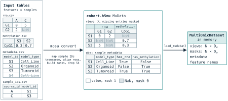

# Preparing a dataset

This page explains how to organise omic measurements and sample metadata, convert them into a MOSA dataset, and check the result before training. MOSA reads [MuData](https://mudata.scverse.org/stable/) stored as `.h5mu` files or `.zarr` directories. If your measurements are in separate tables, [`mosa convert`](../reference/commands/convert.md) aligns them by sample identifier and records which values are missing.

Each omic dataset is a *view*. Views can have different features and need not contain exactly the same samples: a sample measured in one view can have missing measurements in another. Sample identifiers must refer to the same biological samples across tables for the alignment to be meaningful.

## Organise the input tables

Before conversion, process each dataset according to its omic type, origin, and quality. This may involve quality control, data cleaning, normalization, or harmonizing feature identifiers across sources. The appropriate operations depend on the data; conversion only aligns and stores the prepared measurements.

Arrange the processed measurements as one table per omic view, with a separate metadata table describing the samples. The commands below use `data/gexp.csv`, `data/meth.csv`, and `data/metadata.csv`; replace these paths with your own files.

### Omic measurements

Arrange each view with features as rows and sample IDs as column headers. The first column contains feature identifiers; the remaining cells contain numeric measurements:

```csv
feature,SIDM00001,SIDM00002,SIDM00003
SLC7A11,6.42,5.11,7.30
CDKN2A,2.10,NaN,3.02
```

Use an empty cell or `NaN` for an unobserved measurement. Keep measured zeros as zero, since the model must distinguish an observed zero from missing data. Views do not need matching feature names unless you explicitly request a shared-feature intersection.

Supported table formats are `.csv`, `.tsv`, `.txt`, `.tab`, `.parquet`, and `.pq`; delimited files can use `.gz`, `.bz2`, `.xz`, or `.zip` compression. Tab-separated files use tabs between columns. For [Parquet](https://parquet.apache.org/), retain feature identifiers as the table index or its first column.

### Sample metadata

The metadata table has one row per sample. For example:

```csv
model_id,model_type,tissue
SIDM00001,source_A,Lung
SIDM00002,source_A,Breast
SIDM00003,source_B,Lung
```

`model_id` must be unique and match the sample IDs in the omic tables. `model_type` identifies the source or batch and is required even when all samples come from one source. It is used for source-stratified splitting and, by the MOSA VAE, for decoder conditioning and optional adversarial training. It does not select the integration model; that is the role of `model.type` in the experiment configuration.

`tissue` is optional for training. It supplies labels for tissue conditioning and contrastive training when enabled, and is required by [`mosa plot`](../reference/commands/plot.md). Keep the labels consistent across datasets that will be trained or projected together.

To provide mutation conditionals, pass a binary features-by-samples table with `--mutations data/mutations.csv`. Each feature becomes a `mutation_*` metadata column. Mutation tables must already use the metadata's sample IDs. Missing mutation entries and samples absent from that table are filled with zero, so check that this treatment is appropriate for your data.

## Convert the tables

Once the tables are ready, use [`mosa convert`](../reference/commands/convert.md) to name each view and provide its path:

```bash
mosa convert --conditionals data/metadata.csv \
  --view gexp:data/gexp.csv \
  --view meth:data/meth.csv \
  --output data/data.h5mu
```

The `--conditionals` argument supplies sample metadata. In each `--view name:path` argument, the name becomes the view identifier in the saved file, configuration, and reconstruction filenames. Choose names you can use consistently throughout the experiment.

Conversion preserves the supplied measurement values. It does not perform assay-specific normalization, scaling, or imputation. The VAE fits its own scaling and imputation using training samples; any preprocessing you perform beforehand must also respect the evaluation split when estimating statistics from the cohort.

[Zarr](https://zarr.dev/) is a storage format that divides arrays into compressed chunks. This allows lazy loading: reading only the chunks needed for an operation rather than loading the entire array into memory. To save the dataset in this format, replace the output argument with `--output data/data.zarr --format zarr`.

### Alignment

By default, conversion retains samples that appear in the metadata and at least one view table, then sorts them by identifier. Samples found only in metadata or only in the omic tables are excluded. A retained sample absent from a view receives missing values for all features of that view.

If providers use different identifiers for the same samples, supply `--id-map data/id-map.csv`. This table maps `source_id` to the canonical `model_id` used in metadata. The mapping applies to omic tables; metadata and mutation tables must already use canonical IDs.

<p align="center">
  
</p>

In this example, RNA identifiers `A` and `C` map to `S1` and `S3`. Both views are aligned to `S1`, `S2`, `S3`; `S4` is excluded because it appears only in metadata. The measured RNA zero retains a true mask entry, while missing measurements have false mask entries. The `has_rna` and `has_methylation` columns record which input tables contained each sample.

After conversion, [`mosa convert`](../reference/commands/convert.md) prints a summary in the terminal called the *conversion report*. It lists the number of samples retained and excluded, the feature count for each view, and how many samples appear in one, two, or more views.

Use this summary to check that conversion retained the cohort you intended. Samples excluded because they lack metadata or do not appear in any view table are counted separately. If more samples were excluded than expected, compare the identifiers in the metadata and omic tables for naming differences.

### Combining files for one view

If an omic is distributed across several files, repeat its view name:

```bash
mosa convert --conditionals data/metadata.csv \
  --view gexp:data/gexp-source-a.csv \
  --view gexp:data/gexp-source-b.csv \
  --view meth:data/meth.csv \
  --output data/data.h5mu
```

MOSA combines the samples and retains the union of features within that view. Features absent from one file are missing for its samples. If a sample ID occurs twice within the combined view, conversion rejects the collision by default. Resolve duplicate or conflicting measurements before conversion; `--on-collision first` is available when retaining the first occurrence is the intended choice.

### Filtering

Use conversion filters when the intended cohort excludes samples or requires a minimum amount of omic coverage:

| Option | When to use it |
|---|---|
| `--min-views N` | Keep samples with at least one observed measurement in each of at least N views. This does not require complete profiles within those views. |
| `--filter COLUMN=VAL[,VAL...]` | Restrict the cohort to selected metadata values, for example `tissue=Lung,Breast`. Filters on different columns combine with AND; repeating a column replaces its earlier filter. |
| `--shared-features` | Restrict every view to shared feature identifiers, when all views use the same identifier namespace, such as genes. |

These options select samples or features without changing retained measurements. Check the report after filtering to confirm the remaining cohort matches your intention.

## File contents

Within the saved [MuData](https://mudata.scverse.org/stable/) object, each view stores measurements in `X` as samples × features, with an equally shaped Boolean `mask` layer. A true mask entry marks an observed measurement. Sample metadata is stored in `.obs`, along with mutation conditionals and `has_<view>` columns.

Each `has_<view>` column records whether a sample was included in the corresponding input table. For example, `has_gexp` is `True` when the sample ID appears as a column header in the `gexp` table, even if every measurement in that column is missing. The `mask` records availability at the measurement level: each sample–feature entry is `True` for an observed value and `False` for a missing value.

A sample included in the `gexp` table with no recorded measurements therefore has `has_gexp = True`, while its entire row in the saved `gexp` mask is `False`. The conversion report counts this sample as present in the input table. [`mosa inspect`](../reference/commands/inspect.md) counts it as having no observed data in that view, so the two reported sample counts can differ.

### Using a dataset prepared in Python

You can also create a [MuData](https://mudata.scverse.org/stable/) dataset in your own [Python](https://www.python.org/) code, or use one saved by another tool. Before using that dataset with MOSA, check that it has the structure described above. [`mosa convert`](../reference/commands/convert.md) creates this structure automatically.

In a [MuData](https://mudata.scverse.org/stable/) object named `mdata`, `mdata.obs` is the shared sample metadata table, indexed by sample ID. Every view must contain those same sample IDs in the same order, so a given row refers to the same sample throughout the dataset. Each view also needs a Boolean observed-value mask in `layers["mask"]`, with the same dimensions as its measurement matrix. The shared `mdata.obs` table must contain `model_type`, even when all samples have the same source label.

Add other sample annotations, such as tissue, as columns in `mdata.obs`. Avoid using `mdata.obsm["<view name>"]` for these annotations: [MuData](https://mudata.scverse.org/stable/) uses those entries to record which samples belong to each view.

## Check the dataset before training

```bash
mosa inspect --input data/data.h5mu
```

Compare the reported sample IDs, view names, feature counts, value ranges, and missingness with your input tables. Check source-label counts as well: the training holdout needs at least two samples per source and enough samples for the requested fraction, while stratified cross-validation needs at least `n_folds` per source. Warnings about empty or approximately zero-valued views may indicate an input problem.

Use the reported view names in `data.views` and, for the VAE, in `model.views`. If a view should remain unscaled, list it in `data.discrete_views`. The VAE then retains observed values and fills missing entries with zero, but still uses squared-error reconstruction; marking a view as discrete does not introduce a discrete likelihood.

Once these checks pass, follow [Training and projection](training.md) to configure and fit the model. The [convert reference](../reference/commands/convert.md) lists all command options.
