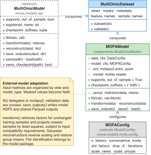

# MOFA integration

This page explains how to fit [MOFA+](https://biofam.github.io/MOFA2/) through MOSA, reuse its saved model, and evaluate its reconstructions. The optional adapter connects the external factor-analysis model to MOSA's dataset format and experiment commands, allowing you to use it alongside the MOSA VAE within the same library workflow.

[MOFA+](https://biofam.github.io/MOFA2/) represents samples through shared latent factors and view-specific feature weights. The adapter fits the model using [`mofapy2`](https://biofam.github.io/MOFA2/) and reads saved models using [`mofax`](https://github.com/bioFAM/mofax). Its preprocessing, likelihoods, and prediction procedure are specific to this integration; the VAE's network and loss settings do not apply.

## Install the optional dependencies

From the repository root, with the MOSA environment active, install the optional dependency group:

```bash
python -m pip install -e ".[mofa]"
```

This provides CPU training. For GPU training, install [CuPy](https://cupy.dev/) for the [CUDA](https://developer.nvidia.com/cuda-toolkit) version on your NVIDIA system, then enable `model.gpu_mode`. The optional dependency group does not install that GPU backend. The [configuration reference](../reference/configuration/mofa.md) lists device settings.

## Prepare the data

Use a dataset prepared according to [Preparing a dataset](../guides/preparing-data.md). The `model_type` column defines source groups, which the external model uses when fitting the views. Tissue and mutation annotations do not become VAE-style conditionals in this integration.

Sample IDs, feature names, view names, and group labels must use ASCII characters because the saved-model reader decodes them that way. Use identifiers without accented letters or other non-ASCII characters, and keep them consistent between fitting and projection.

Likelihood selection depends on the observed values in each view. Binary values select Bernoulli, integer values select Poisson, and other values select Gaussian. The choice is inferred during fitting; listing a view in `data.discrete_views` does not select its likelihood. The adapter converts masked entries and R's integer missing-value code `-2147483648` to missing values before fitting.

Check the inferred likelihoods in the training output. Fitting supports missing measurements and the backend's likelihoods, but the adapter's new-sample projection and reconstruction on the input scale require Gaussian views. This requirement also applies when evaluating held-out samples.

## Configure and fit the model

The following examples use the continuous synthetic dataset from [Getting started](../getting-started.md). The supplied [mofa.yaml](../examples/mofa.yaml) selects both views and fits three factors:

```yaml
data:
  path: outputs/tutorial/data.h5mu
  views: [gexp, meth]
model:
  type: mofa
  output_dir: outputs/tutorial/mofa-run
  random_seed: 42
  n_factors: 3
  iterations: 100
  drop_r2: null
evaluation:
  test_size: 0
  n_folds: 3
  strategy: stratified
  shuffle: true
```

`n_factors` sets the initial factor count, and `iterations` limits fitting updates. This small example uses `drop_r2: null` to retain factors rather than removing them according to explained variance. Adapt the factor count, convergence settings, and training budget for your own dataset; the [configuration reference](../reference/configuration/mofa.md) describes these controls.

Validate the configuration with [`mosa validate`](../reference/commands/validate.md), then fit with [`mosa train`](../reference/commands/train.md):

```bash
mosa validate --config docs/examples/mofa.yaml
mosa train --config docs/examples/mofa.yaml
```

`evaluation.test_size: 0` includes all 60 samples in fitting. A nonzero holdout would reserve samples, but this adapter does not use them for fitting or early stopping and does not include them in the fitted-cohort export. Use cross-validation when you want to assess reconstruction on excluded samples.

Keep these settings in a separate configuration from the VAE run. Fields such as `model.views`, `preprocessing_mode`, and `adv_weight` belong to the VAE and are rejected for `model.type: mofa`. Training cannot be resumed: passing `--resume` starts a fresh fit with a warning.

## Read the saved results

The example writes `outputs/tutorial/mofa-run/mofa_model.hdf5`, containing the fitted model and MOSA's preprocessing metadata. The neighbouring `full/` directory contains `latent.parquet` with sample factors and `recon_<view>.parquet` with reconstructed Gaussian views on the input scale. Here, `full/` refers to samples passed to fitting; it excludes any reserved validation samples.

For a non-Gaussian view, training skips the reconstruction export with a warning. Latent factors can still be exported for fitted samples, but `reconstruct()` rejects non-Gaussian views. The adapter does not produce the VAE's separate training, validation, or conditional-source exports, or its [PyTorch Lightning](https://lightning.ai/docs/pytorch/stable/) loss logs. See [Saved files](../reference/saved-files.md) for the common table layout.

## Project new samples

For fitted samples with unchanged measurements, the adapter returns their learned factors. For new samples, it estimates factors from the saved feature weights using the available Gaussian measurements, after applying training-derived group centering and scaling. It solves the views jointly by minimum-norm least squares, so the resulting coordinates are a deterministic projection into the fitted factor space. This uses the fitted weights and does not perform posterior inference in the external backend.

Before projection, check that the new dataset retains every trained view with identical feature names and order. Missing entries, including an entirely missing view for a sample, can remain masked. Each new sample must have at least one observed feature and a `model_type` group represented during fitting. Use new sample IDs for new observations: reusing a fitted sample ID with changed values is rejected.

Prepare `outputs/tutorial/new-data.h5mu` using the [new-sample conversion example](../guides/training.md#prepare-new-samples), then run [`mosa transform`](../reference/commands/transform.md):

```bash
mosa transform --checkpoint outputs/tutorial/mofa-run/mofa_model.hdf5 \
  --input outputs/tutorial/new-data.h5mu \
  --output outputs/tutorial/mofa-projection --reconstruct
```

This writes factors for the 12 new samples to `latent.parquet` and Gaussian-view predictions to `recon_gexp.parquet` and `recon_meth.parquet`. Use a separate projection directory to retain earlier results. The saved file must include the preprocessing metadata written by this adapter to project new samples or reconstruct on the input scale.

## Evaluate and optimize

For Gaussian views, [`mosa cross-validate`](../reference/commands/cross-validate.md) fits a fresh factor model per fold and projects the held-out samples through the adapter:

```bash
mosa cross-validate --config docs/examples/mofa.yaml
```

The held-out samples must belong to groups seen in that fold's training subset. Source-stratified folds help maintain group coverage, provided each group has enough samples. The resulting NMSE measures reconstruction from the adapter's projection procedure; see [Evaluation and optimization](../guides/evaluation.md#scoring) for score interpretation.

To search the factor count, use the supplied [search-space file](../examples/mofa-search-space.yaml), which chooses among two, three, and four factors:

```bash
mosa optimize --config docs/examples/mofa.yaml \
  --search-space docs/examples/mofa-search-space.yaml --trials 2
```

[`mosa optimize`](../reference/commands/optimize.md) evaluates each combination through cross-validation. Copy the selected values into a new experiment configuration and fit a final model with [`mosa train`](../reference/commands/train.md). VAE parameters such as `joint_latent_dim` are not interchangeable with the factor model's `n_factors` setting.

## Adapter structure

The diagram shows how the adapter translates the common model interface into backend fitting, saved-model reading, and prediction. For another external integration, follow [Adding a model](../development/adding-models.md).

<p align="center">
  
</p>

For dependency, input, or projection errors, see [MOFA troubleshooting](../reference/troubleshooting.md#mofa-integration).
