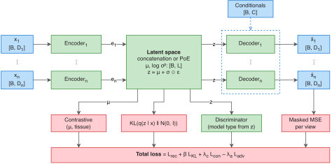

# The MOSA VAE

The MOSA VAE is the library's main integration model: a conditional multiview variational autoencoder for bulk multi-omics data. It combines a configurable number of omic views into a shared latent representation and reconstructs their measurements, including profiles with missing entries or missing views.

Conditioning lets the decoders use source, tissue, and mutation information when estimating profiles. Optional adversarial training discourages source information in the latent representation, while a tissue-based contrastive objective can encourage tissue-related structure. This page explains how these components work and how their settings affect training and prediction. Select the model with `model.type: mosa_vae`; exact fields and defaults are listed in the [configuration reference](../reference/configuration/mosa-vae.md).

<p align="center">
  
</p>

The diagram shows the first and last configured views, with the intermediate views omitted for space. B denotes minibatch size, Dᵢ the feature count of view i, L the shared latent dimension, and C the combined conditioning dimension. Each view can have its own feature count and encoder dimensions.

## Encoders, fusion, and decoders

Each view has an encoder that maps its preprocessed measurements to an embedding. The encoders are multilayer perceptrons, with widths and depths defined by each view's `hidden_layer_dims`. A fusion step combines their outputs to infer a Gaussian distribution over the sample's shared latent coordinates, represented by its mean `mu` and log-variance `logvar`.

During training, a latent vector `z` is sampled from this distribution. During prediction, the model uses its mean, so repeated predictions from fixed weights and inputs produce the same coordinates. Each view's decoder receives the shared latent vector together with the sample's conditions and estimates that view's measurements. Decoder hidden-layer sizes mirror the corresponding encoder in reverse order.

`model.joint_latent_dim` determines the number of shared latent coordinates. `model.fusion_method` determines how the view outputs are combined:

| Method | Combination of views |
|---|---|
| `concat` | Embeddings occupy fixed slots in a concatenated vector, which linear layers map to `mu` and `logvar`. An entirely missing view contributes a zeroed embedding. |
| `poe` | Each view supplies Gaussian statistics. A product of experts combines the available views with a standard-normal prior, weighting their contributions by precision, the inverse of variance. A model configured with only one view uses that view's posterior directly. |

For product-of-experts fusion, `poe_use_shared_head: true` uses the same posterior network for all views and requires equal final encoder widths. With `false`, each encoder emits its own mean and log-variance. `shared_hidden_layer_dims` configures additional layers in the shared posterior network; it is not used by concatenation fusion.

## Missing observations

The model uses the observed-value masks stored with each view to distinguish measurements from missing entries. Before encoding, missing values are filled according to the preprocessing mode. They remain excluded from reconstruction loss, so an imputed encoder input is not treated as an observed target.

When a sample has no measurements in a view, that encoder's embedding is set to zero and the view contributes no reconstruction loss for that sample. Product-of-experts fusion also excludes the missing view's expert. The other observed views can still contribute to the shared representation and predictions.

`view_dropout_prob` adds random interruptions to the encoder inputs during training: an entire view's input is zeroed for a minibatch with the configured probability. The observation masks and reconstruction targets remain unchanged, allowing the model to learn reconstruction when an encoder receives no measurements from that view.

Prediction returns values for every configured view and feature, including positions that were unobserved. To assess those estimates, use independent measurements or held-out evaluation. New datasets must retain the trained views and feature order, with missing entries marked in their masks; [Training and projection](../guides/training.md#prepare-new-samples) explains how to prepare them for [`mosa transform`](../reference/commands/transform.md).

## Decoder conditioning

Every decoder receives the sample's source label from `model_type`. Tissue is included when `data.use_tissue` is enabled and a `tissue` column is available. Mutation conditionals are included when `data.use_mutations` is enabled and the dataset contains `mutation_*` columns.

These conditions are supplied to the decoders rather than the encoders. They allow reconstruction to depend on source and biological annotations in addition to the shared representation. Conditioning alone does not prevent the encoders from retaining source information; the adversarial objective addresses that through training.

### Conditional reconstruction

Ordinary reconstruction uses each sample's recorded source label. Conditional reconstruction replaces that label with a chosen source while keeping the encoded representation, tissue, and mutation conditions fixed. It estimates the profile the decoder would produce for that sample under the selected source condition.

To generate this export during training, set the following fields inside the configuration's `model` block:

```yaml
inference: true
target_batch: source_0
```

Replace `source_0` with a source represented during fitting. If `target_batch` is empty, the first fitted source category is used. After [`mosa train`](../reference/commands/train.md), the additional `inference/` directory contains latent coordinates and reconstructed profiles for the full cohort. The latent coordinates are retained from ordinary encoding; the source change acts on decoding and, for source-centred preprocessing, the inverse transformation.

Interpret the profiles as model estimates under a changed condition. When source and biological state are associated in the training data, that change may also affect biological differences represented by the source label. Independent evidence is needed to interpret it as a biological or technical effect.

## Training objectives

Training combines reconstruction, KL regularization, and the enabled contrastive and adversarial terms. The VAE minimizes:

```text
reconstruction + kl_weight × KL
               + contrastive_weight × contrastive
               − adv_weight × source classification loss
```

The discriminator has its own update that minimizes source classification loss. The subtraction in the VAE objective gives the encoders the opposing goal of making source prediction harder.

### Reconstruction and KL regularization

Reconstruction uses squared errors at observed positions. For each view, errors are first averaged over the observed features of each sample. `loss_type: mean` then averages those sample losses, so samples with more observed features do not automatically receive greater weight. `loss_type: macro` instead averages sample losses within source groups and gives each represented group equal weight. The view's `recon_weight` scales its contribution before the view losses are summed.

The KL term regularizes the inferred Gaussian distribution towards a standard normal. It is summed over latent dimensions and averaged over samples, so its magnitude depends on latent width as well as the posterior parameters. `kl_weight` controls its contribution. When the KL scheduler is enabled, that weight transitions towards `kl_weight_final` over `kl_warmup_epochs`; consider the weight and latent width together when comparing configurations.

### Source discriminator

Setting `adv_weight` above zero enables a discriminator that predicts the sample's `model_type` from the sampled latent vector `z`. It receives the latent representation rather than the omic measurements or decoder conditions. For latent width L and K source categories, it has two hidden layers of width L with BatchNorm and ReLU, followed by K output logits.

Each training batch first updates the discriminator using latent vectors detached from the encoder gradient computation. The VAE update then combines reconstruction and regularization with the opposing source-classification term. This trains the discriminator to detect source information while training the encoders to make that information less predictive.

`adv_learning_rate` controls discriminator updates, while `adv_focal_gamma` and `use_adv_class_weights` adjust its classification loss. More than one source category is needed for a meaningful discrimination task. Assess source mixing alongside biological structure and reconstruction: source labels can also be associated with biological differences that adversarial training may suppress.

### Tissue contrastive objective

Setting `contrastive_weight` above zero adds a supervised contrastive loss on posterior means `mu`. Tissue labels define positive and negative sample pairs, encouraging similar representations within a tissue and separation between tissues under the loss's cosine-similarity criterion.

For tissue-based contrastive training, supply a `tissue` column and enable `data.use_tissue`. The implementation uses the tissue labels prepared with that setting for both decoder conditioning and the contrastive objective. The contrastive and adversarial weights are independently configurable and both default to zero. See the [loss settings](../reference/configuration/mosa-vae.md#losses) for their complete configuration.

## Preprocessing

The VAE fits preprocessing on the training subset and stores the resulting statistics with the model. Validation and new samples reuse those statistics, and reconstructions are transformed back to the input scale before export.

| `preprocessing_mode` | Processing of continuous views |
|---|---|
| `standardize` | Subtract each feature's observed training mean and divide by its training standard deviation. Missing entries become zero in standardized space. |
| `center` | Subtract each feature's training mean within the sample's source group. Missing entries become zero in centred space. |
| `none` | Retain observed measurements on the input scale and fill missing entries with training source-group means. |

For group-based processing, the global training mean is used where a source group has no observations for a feature. Views listed in `data.discrete_views` remain unscaled and use zero for missing encoder inputs, but their reconstruction still uses squared error. Marking a view as discrete does not select a binary or count likelihood.

## Configure and assess the model

Use the [VAE configuration reference](../reference/configuration/mosa-vae.md) to set per-view networks, latent fusion, loss weights, and training options. Encoder and decoder dimensions are configurable; changing the network family requires an implementation change, covered in [Modifying the VAE](../development/modifying-vae.md).

Choose settings using [held-out evaluation](../guides/evaluation.md#evaluate-held-out-reconstruction), then examine reconstruction and sample structure with [Analysing results](../guides/analysis.md). These assessments help determine whether improved reconstruction or reduced source separation preserves the distinctions relevant to the study.
