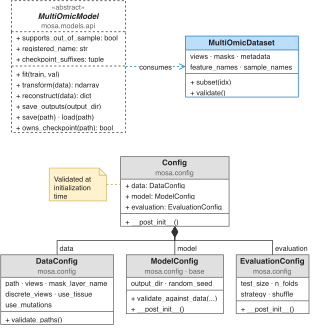

# Model contract

[Documentation](../index.md)

[MultiOmicModel](../../src/mosa/models/api.py) defines the adapter methods. The CLI and evaluator also require the input, prediction, and persistence conventions below; batching and training remain implementation-specific.

  

## Input data

Models receive a [MultiOmicDataset](../../src/mosa/data/dataset.py), with one shared sample axis:

| Field | Meaning |
|---|---|
| `views[name]` | Float32 matrix with shape `(N, P_name)`. Missing values may be NaN. |
| `masks[name]` | Boolean matrix of the same shape; `True` means observed. |
| `metadata` | DataFrame indexed by sample ID, in the matrices' row order. `model_type` is required; tissue and mutations are optional. |
| `feature_names[name]` | Feature identifiers in the matrix's column order. |

Call `data.validate()` to check structural consistency. `subset(indices)` selects samples while retaining feature order. A view can be absent for individual samples even though its key and matrix remain present. Use the masks to decide what is observed; do not turn missing entries into measured zeros.

Each adapter fits its preprocessing, categorical encodings, and missing-value treatment on training samples only, then persists and reuses them for validation and projection. The shared loader does not fit scalers.

## Construction and fitting

`build_model(data_cfg, model_cfg)` calls the registered class with those two arguments. Store both configurations. `fit(train, val=None, resume_from=None)` must accept the interface's named arguments even when validation or resumption is unsupported; explain that behaviour and report it clearly to callers.

The CLI calls `fit()` then `save_outputs()`. Cross-validation calls `fit(train, val)` then `reconstruct(val)` directly, without calling `save_outputs()`. An adapter supporting cross-validation must therefore be able to predict immediately after fitting, even if it materializes a temporary backend artifact internally. The [MOFA](https://biofam.github.io/MOFA2/) adapter uses this approach.

Validation data may influence early stopping, but must not be incorporated into training-derived preprocessing. Create a fresh model state for each fit and respect the supplied output directory; cross-validation replaces it with a temporary directory.

## Prediction

`transform(data)` returns a [NumPy](https://numpy.org/) array of shape `(N, latent_dim)`. `reconstruct(data)` returns a dictionary with arrays of shape `(N, P_view)`. Rows must match the supplied sample order, and reconstruction columns must match each view's feature order. Reconstruction scores compare these arrays directly to the input.

Reverse fitted preprocessing before returning reconstructions: scoring assumes the input scale and feature order. Reject incompatible features, categories, or likelihoods explicitly; shape checks alone cannot detect incorrect order or scale.

Cross-validation expects reconstructions for every configured view, including predictions for missing entries. Its score uses only observed entries. If the method cannot reconstruct a supported view on the input scale, reject that operation rather than silently omitting it.

Set `supports_out_of_sample = False` for transductive methods that cannot reconstruct held-out samples; the default is `True`. Cross-validation and optimization check this flag before fitting, but adapters must still validate features, categories, and likelihoods.

## Persistence

`save(path)` and classmethod `load(path, **kwargs)` own the saved-model format. Save the fitted parameters and every dependency of prediction: preprocessing statistics, source/category mappings, feature order, and data/model configuration where relevant.

After loading, the CLI needs `data_cfg.views` and `data_cfg.mask_layer_name`. `transform()` and `reconstruct()` must work without the original training configuration file. Preserve the meaning of the model's coordinates across the round trip.

### Checkpoint ownership

The registry asks each model class `owns_checkpoint(path)` and loads only when exactly one class claims the file. The default implementation checks `checkpoint_suffixes`. Call `require_checkpoint_suffix(path)` from `save()` to catch a filename that dispatch cannot route back to the class.

Prefer a unique suffix. For shared suffixes, `owns_checkpoint()` must inspect an identifier or file structure, returning `False` for unrecognized or unreadable files. Keep the check inexpensive and independent of training data, as in the VAE and [MOFA](https://biofam.github.io/MOFA2/) adapters.

## Exported results and history

`save_outputs(output_dir=None)` is responsible for creating directories and writing exports. `None` means the configured `model_cfg.output_dir`. To use the library's training-result plots, write `full/latent.parquet` (or the supported `train/` fallback) indexed by sample ID and `recon_<view>.parquet` with feature columns. See [Saved outputs](saved-files.md).

Document which samples `full/` contains and which views support export. Model files and additional split directories are implementation-specific.

`epoch_history` is a list of dictionaries with `epoch` and available `train_loss` / `val_loss` values. Initialize it on each instance to avoid sharing the base class's mutable default. Non-epoch methods can leave it empty. Cross-validation collects this history for its CSV output. The current training-result loss plots read [Lightning](https://lightning.ai/docs/pytorch/stable/) CSV files; an arbitrary history list does not automatically provide those plots.

## Configuration and search

A configuration class must be a `ModelConfig` dataclass subclass. The registry pairs its exact type with one model class and uses the registered name for [YAML](https://yaml.org/) selection. Nested configuration requires explicit parsing through `from_yaml_dict()`.

Optimization uses `dataclasses.replace()` to sample top-level model fields, constructing a fresh configuration per trial. Its `__post_init__()` must reject invalid combinations. Evaluation settings and nested per-view fields are outside the search space. Failed configurations or fits are pruned, but a capability or input restriction should be documented before users start a study.

## Verification

Use small datasets with partial masks, a fully missing view for some samples, distinct feature names, and shuffled sample order. Verify:

- Predicted shapes, row order, and feature order match the supplied dataset.
- Preprocessing is learned from training values only, reused after loading, and reversed in reconstructions.
- New samples either project successfully or are rejected according to the documented capability.
- Unknown categories, changed feature order, and unsupported likelihoods fail clearly.
- Predictions agree before and after save/load, within the method's numeric tolerance.
- Exported Parquets retain sample IDs and feature names, and an explicit output override is respected.
- `reconstruct(val)` works immediately after `fit(train, val)` when held-out evaluation is supported.
- Cross-validation and optimization work through the registry rather than calling the class directly.

[Registry tests](../../tests/test_registry.py) check registered implementations against the interface and drive a dummy external method through the shared workflow. [API tests](../../tests/test_api.py) exercise the current model lifecycles. Add meaningful tests for your method's behaviour and run the [repository checks](../../CONTRIBUTING.md#check-your-changes).
